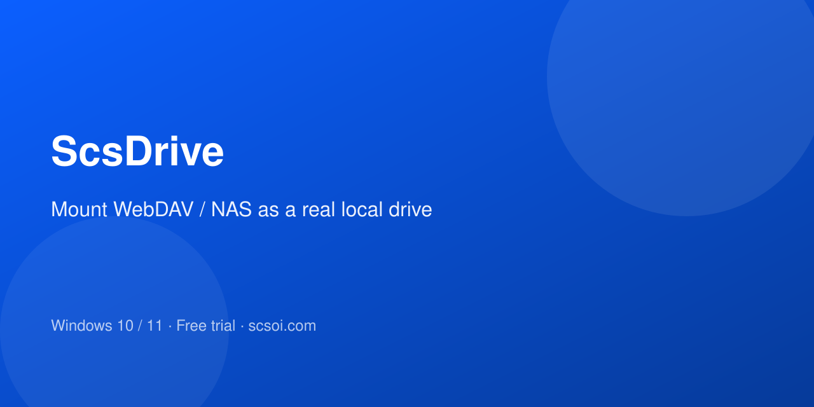
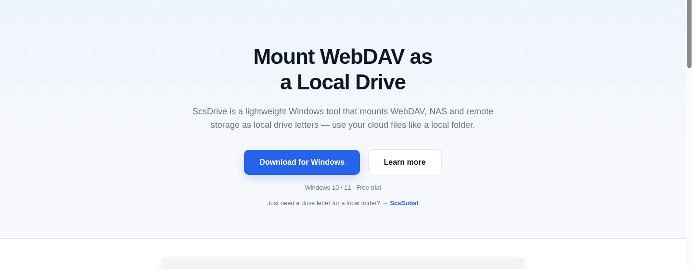

[English](README.md) · [中文](README.zh-CN.md) · [日本語](README.ja.md) · **한국어** · [Español](README.es.md) · [Français](README.fr.md) · [Deutsch](README.de.md) · [Русский](README.ru.md)

  

<h1 align="center">ScsDrive</h1>

  <strong>WebDAV를 로컬 드라이브로 마운트하세요</strong> 
  ScsDrive는 경량 Windows 도구로, WebDAV, NAS 등 원격 스토리지를 로컬 드라이브 문자로 마운트하여 로컬 폴더처럼 클라우드 파일을 사용할 수 있습니다.

  
  
  
  

  <a href="https://drive.scsoi.com/#download"><strong>다운로드</strong></a> ·
  <a href="https://drive.scsoi.com/#pricing"><strong>가격</strong></a> ·
  <a href="https://github.com/shuyingegit/scsdriver/releases"><strong>릴리스</strong></a> ·
  <a href="https://subst.scsoi.com"><strong>ScsSubst</strong></a>

---

## ScsDrive를 쓰는 이유

ScsDrive는 경량 Windows 도구로, WebDAV, NAS 등 원격 스토리지를 로컬 드라이브 문자로 마운트하여 로컬 폴더처럼 클라우드 파일을 사용할 수 있습니다.

  

## 핵심 기능

간단하고 안정적이며 번거롭지 않습니다.

- **원클릭 마운트** — WebDAV URL과 자격 증명을 입력하면 로컬 드라이브로 마운트됩니다. 매번 수동으로 연결할 필요가 없습니다.
- **네이티브 경험** — 로컬 폴더처럼 탐색, 편집, 드래그 가능. 앱이 직접 읽고 쓸 수 있습니다.
- **자동 시작** — 부팅 시 자동으로 재연결. 수동 개입 없이 항상 사용 가능합니다.
- **경량 및 안정성** — 성숙한 커널 기반. 낮은 리소스 사용, 장시간 안정적으로 실행됩니다.
- **다중 서버** — 여러 WebDAV / NAS 서비스를 동시에 마운트. 독립된 드라이브 문자로 간섭하지 않습니다.
- **보안 연결** — HTTPS 암호화 연결 지원. 자격 증명은 안전하게 저장됩니다.
- **비밀번호 없이 먼저 연결** — 시작 시 자동 연결을 포함해 비밀번호 없이 연결되며 드라이브가 보입니다. 저장하지 않으면 들어갈 때마다 한 번 입력하고, 나갔다가 다시 들어가면 또 입력합니다.

## 다운로드

최신 빌드: **[GitHub 릴리스](https://github.com/shuyingegit/scsdriver/releases/latest)** · [웹사이트](https://drive.scsoi.com/#download)

| 패키지 | 용도 |
|--------|----------|
| **Portable (`.zip`)** | 압축 해제 후 실행(권장) |
| **Installer (`.exe`)** | 설치 프로그램 |

시스템 요구사항: Windows 10 / 11 (64비트)

## 가격

무료 체험은 7일부터. 친구를 초대하면 양쪽 모두 체험을 늘릴 수 있습니다.

모든 플랜(무료 체험 포함)에 기술 지원 포함. 사용 중 오류나 문제가 있으면 이메일로 알려주세요. 확인·수정하고 지속 개선하겠습니다.

## 관련 제품

기존 로컬 폴더를 드라이브 문자로 매핑. 복사 없음.

→ **[ScsSubst](https://github.com/shuyingegit/scssubst)** · [subst.scsoi.com](https://subst.scsoi.com)

## 자주 묻는 질문

**ScsDrive는 어떤 WebDAV 서비스를 지원하나요?**  
표준 WebDAV 프로토콜을 지원하는 모든 서비스를 지원합니다. 자체 NAS(Synology, QNAP 등), Nextcloud, Nutstore 등.

**체험판과 정식판의 차이점은 무엇인가요?**  
기능은 같습니다. 체험은 7일, 친구 초대 코드로 시작하면 14일이 됩니다. 친구가 내 코드로 체험을 시작하면 나도 +7일(제한 없음). 무기한 구매는 제외. 체험 후에는 라이선스가 필요합니다.

## 라이선스 및 약관

이용약관 · 개인정보 처리방침 · 환불 정책 — [https://drive.scsoi.com/terms](https://drive.scsoi.com/terms) · [https://drive.scsoi.com/privacy](https://drive.scsoi.com/privacy) · [https://drive.scsoi.com/refund](https://drive.scsoi.com/refund)

---

  <a href="https://drive.scsoi.com/"><strong>웹사이트 열기 →</strong></a>

